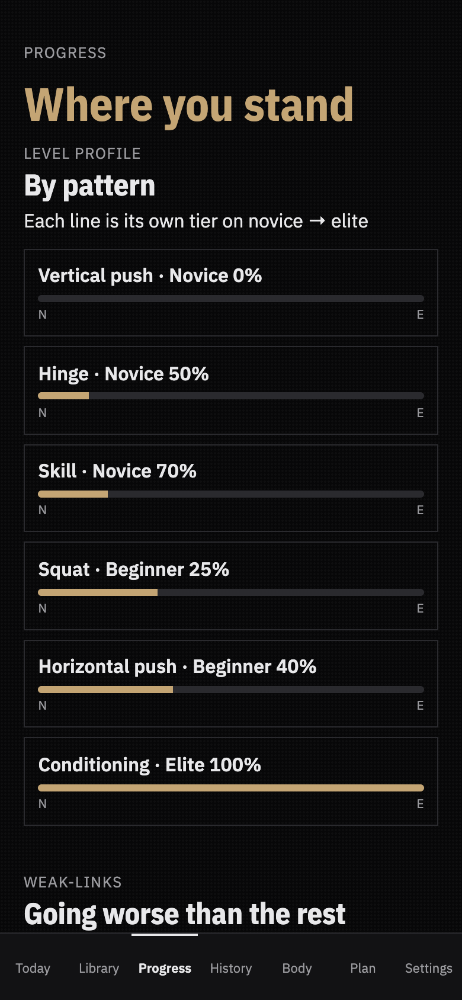

# Aurora · Rassvet

[](LICENSE)
[](https://github.com/avnovikov/aurora/actions/workflows/ci.yml)
[](https://github.com/avnovikov/aurora/releases)

**v0.1.2 — from the `mvp` release line.** Day-to-day development targets **`dev`**; `mvp` is for releases. App id `com.aurora.alvorada` (registered in Android Developer Console). Release notes: [docs/RELEASE_NOTES.md](docs/RELEASE_NOTES.md).

**Aurora** is private, local-first calisthenics training for Android. **Rassvet** (Рассвет, “dawn”) is the soul mark shown in the app. The UI and spoken voice are British English (`en-GB`).

You pick a **Target** — a skill goal such as freestanding handstand or muscle-up. Aurora keeps programming the **current step** on that path (not the end skill every session) and **Progress** shows how close you are. Area days (upper body, legs, core, …) sit in the same **plan queue** and still adapt when sleep, joints, or stalls say so.

The Library has **700+ exercises** (strength progressions, holds, mobility, and kettlebell work). Major calisthenics apps advertise roughly **350+** (Madbarz), **700+** (Calisteniapp), and **1,000+** (Thenx) — Aurora sits on the upper side of that range on catalogue size, without a subscription.

Aurora is for people who train calisthenics at home and want each session aimed at a real skill, then adjusted for recovery, equipment, and recent performance. Training apps usually give you a weekday calendar and a static template. Sleep, joints, and pulse change what you should do before you start. Aurora keeps a plan queue instead of a fixed Monday–Sunday grid, and adjusts the **dose** from sleep, optional pain, recent load, missed reps, stalls, and (on Android) a Bluetooth heart-rate strap.

## Why I wrote it

Four gaps in the apps I used are why I wrote Aurora.

1. Those apps sold “technique guides” as a separate product. I wanted a **Target** in the plan itself: pick the skill, train today’s step toward it, and see distance on Progress — without a subscription course catalogue.
2. Those apps did not remember my joint problems: past injuries, and joints I need to skip or ease. Aurora stores them and eases or skips the moves that load those joints.
3. Those apps did not change the plan when I plateaued — when progress had stalled and the same work kept coming back. Aurora changes the plan when progress stalls.
4. A typical app of this kind costs about £60 a year. I give Aurora away free as in beer (no charge) and free as in speech (the source is under the MIT licence).

## Download

**[Download Aurora v0.1.2 for Android](https://github.com/avnovikov/aurora/releases/latest)**

Install the APK by allowing installation from your browser or file manager when Android asks.

**Updates with [Obtainium](https://github.com/ImranR98/Obtainium):** add the repo URL `https://github.com/avnovikov/aurora`, or open the one-tap link [Add Aurora in Obtainium](obtainium://add/https://github.com/avnovikov/aurora) on a phone that already has Obtainium installed.


*The Today screen: Aurora shows the next queued session, asks how you slept and whether anything hurts, and lets you connect a heart-rate strap before you start.*

New to Aurora? Follow the [First-morning tutorial](docs/tutorial/take-your-first-morning-with-aurora.md) for a guided walkthrough from setup through your first session (Settings → Library → Plan → Today → Session → Progress → History → Body).

---

## Requirements

- An Android phone or tablet (minimum Android 6 / API 23)
- The Aurora APK from [GitHub Releases](https://github.com/avnovikov/aurora/releases/latest)
- Optional: a Bluetooth heart-rate strap (connection works in the Android app only)

App id: `com.aurora.alvorada`.

---

## How Aurora works

### Target, then the queue

A **Target** is the skill end-goal on a path — for example freestanding handstand, muscle-up, front lever, or pistol squat. Plan days aimed at that skill train the **step you can do now**; Progress treats the Target as the north star and shows how close you are.

A **plan queue** is an ordered list of upcoming training days, not a Monday–Sunday calendar. **Today** always runs the first day in the queue. Completing a session advances the queue.

An **area day** is a planned training day focused on one body area or a skill path: Upper body, Lower body, Core, Full body, Mobility, Joint care, or a day aimed at a Target (for example a handstand or muscle-up path).

### Set up once

Enter bodyweight, resting and maximum heart rate, past injuries, and the gear you own. First-run screens collect that before the main tab bar appears.

### Adapt the dose

A **station** is one exercise or movement block in a session. It may prescribe one or more sets, repetitions, or a hold time.

The **dose** is the prescribed work for each station: sets, repetitions, or hold time. Poor sleep or marked pain lightens that work when you start. Recent load, missed reps, stalls, and pulse can also lighten it. Dose changes how hard today’s step is; it does not replace the Target.

### Train in one flow

When you start, a **Session** temporarily replaces the main tab bar with a guided flow: warm-up stations → work → cool-down → a short rating. When you finish, you return to the tabs.

Swipe left to complete the current set or station. During **Rest** and **Get ready** (the short period before the next set), swipe left to end the wait and continue.

### Progress toward Targets

On **Progress**, **current readiness** shows how close you are to your **Targets** and the next steps on those paths (for example how near you are to the handstand or muscle-up you set on Plan). The level profile and weak-links sit beside that. Separately, the morning check-in (sleep and optional pain) feeds how light today’s dose is — recovery for this session, not a substitute for Target distance.

---

## The main tabs

The Android app’s main tab bar, in order:

| Tab | What it shows |
|-----|----------------|
| Today | Next day in the plan queue; ≈ minutes; pulse Connect; sleep check-in (required before Start); optional pain |
| Library | Exercise catalogue; search; filters Show / Area & muscle / Level; detail with cues, standards, personal bests |
| Progress | Level profile by movement pattern (novice→elite, within-tier %); weak-links; current readiness toward Targets |
| History | Sessions (plan · when · assessment; exercises rolled up as reps/reps + optional avg BPM); legacy rows stay session summaries |
| Body | Muscle load front/back map and ranked list; Week / Month / Quarter / Half year / Year |
| Plan | Queue of upcoming days (area days and skill paths with Targets); Swap / Easier; remake area or skill; reorder; add days; plan level |
| Settings | You / Gear / Training / App |


*The Plan screen: upcoming days in queue order. Today is the first card; skill days carry a Target.*


*A Session: one station at a time — cues, dose, and a left swipe to finish the set or station.*



*Progress: level by movement pattern, then how close you are to your Targets (for example handstand or muscle-up).*

Screenshots for every surface live under `docs/help/screenshots/`.

---

## Tutorial

The [First-morning tutorial](docs/tutorial/take-your-first-morning-with-aurora.md) is the detailed walkthrough with screenshots. Use it once you have the APK installed; this README stays at orientation level.

For a compact tab and Session lookup: [Shell-tab reference](docs/reference/aurora-shell-tabs.md).

---

## Docs

| Document | Contents |
|----------|----------|
| [First-morning tutorial](docs/tutorial/take-your-first-morning-with-aurora.md) | Guided walkthrough with screenshots |
| [Shell-tab reference](docs/reference/aurora-shell-tabs.md) | Tabs, Session, first-run screens, plan-queue terms, storage keys |
| [Terms](docs/TERMS.md) | Use conditions, licence, medical disclaimer |
| [Privacy](docs/PRIVACY.md) | Local-only data; GDPR and CCPA/CPRA checklist |
| [Development guide](docs/development.md) | Local preview, Android build, tests, branches, snapshots |
| [Lightsail deployment](docs/deploy/lightsail.md) | Optional HTTPS hosting for a later PWA experiment |

---

## Install details

1. Download the APK from the [latest GitHub Release](https://github.com/avnovikov/aurora/releases/latest).
2. Open the file on the phone and allow installation from that source when Android asks.
3. Optional but recommended if you have Android SDK build tools: verify the signing certificate.

To get updates without checking Releases by hand, install [Obtainium](https://github.com/ImranR98/Obtainium), then Add App with `https://github.com/avnovikov/aurora` (or use [Add Aurora in Obtainium](obtainium://add/https://github.com/avnovikov/aurora)). Leave prereleases off unless you want betas.

### Optional but recommended: verify the APK

```bash
apksigner verify --print-certs path/to/app-release.apk
```

Compare the `SHA-256 digest` in the output with:

```text
ff5e2dd6fd5ba34b3baca196a7e442a6492a5a22d786dc040e9850ac8529f3a6
```

If the values do not match, do not install the APK.

Release APKs are signed locally. The signing keystore is not stored in Git or used by CI. See `android/keystore.properties.example`.

Heart-rate-strap connection requires the Android app.

---

## Privacy and data (local only)

Training history, sleep answers, pulse readings, pain or joint notes, profile settings, the plan queue, and session logs remain on your device. There is no cloud account and no server sync of that data in 0.1.

Uninstalling Aurora or clearing its app storage permanently deletes your local data. Aurora does not provide cloud backup or account recovery.

On Android, sensitive `aurora.poc.*` values go through **AuroraSecure** (Keystore-backed). A local browser preview used only for development may fall back to plaintext `localStorage`.

Full policy: [docs/PRIVACY.md](docs/PRIVACY.md). Terms of use: [docs/TERMS.md](docs/TERMS.md). **Not medical advice.** Stop if you feel pain, dizziness, or distress.

---

## Develop

Aurora is a TypeScript, Vite, Vitest, and Capacitor Android project. The planning, dose, and progression logic is pure TypeScript with no browser DOM or Bluetooth dependencies, so it is easier to test and reuse.

For local development, Android development, testing, quality checks, branch policy, and device snapshots, see the [Development guide](docs/development.md).

---

## Catalogue

The Library has **700+ exercises** (strength progressions, holds, mobility, and kettlebell work) you can browse and filter. Major calisthenics apps advertise roughly **350+** (Madbarz), **700+** (Calisteniapp), and **1,000+** (Thenx) — Aurora sits on the upper side of that range on catalogue size, without a subscription. Catalogue size is not the product story; Targets, dose, and local-first planning are.

Exercise catalogue imports follow each source’s licence: wger (CC), MuscleWiki (non-profit notice), free-exercise-db, Hugging Face calisthenics imports, and in-house NTC-style cues. Using the catalogue does not transfer those upstream rights beyond what those licences allow.

---

## Licence

[MIT](LICENSE) — Copyright (c) 2026 avnovikov.

---

## Known limitations in v0.1.2

Older history entries created before set-level logging may appear only as session summaries rather than individual sets. Heart-rate-strap connection is available only in the Android app. There is no cloud sync and no account recovery if you lose the phone.
