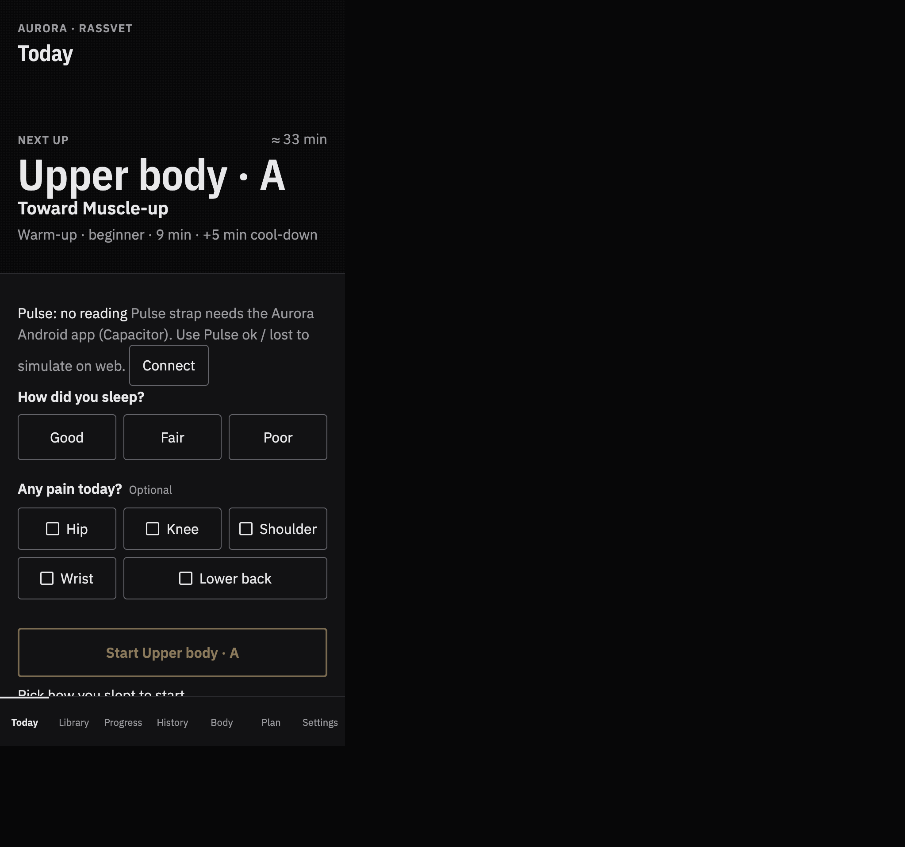
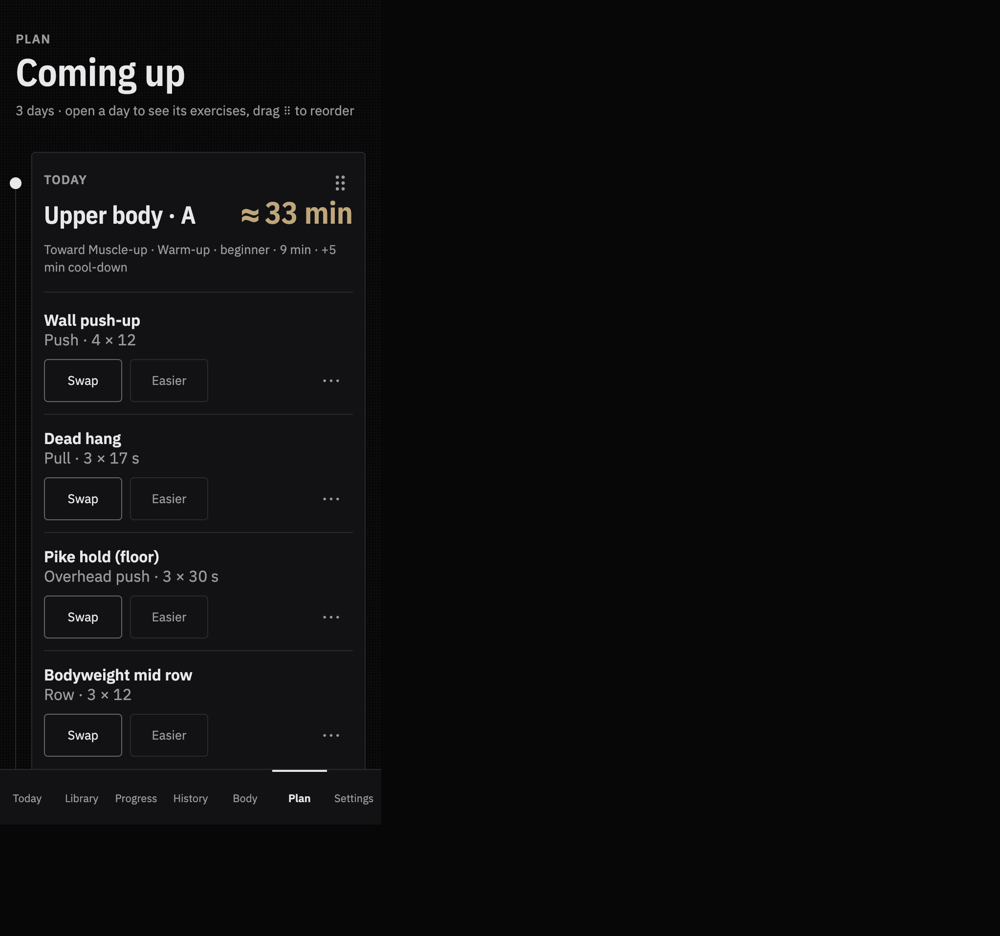

# Aurora · Rassvet

[](LICENSE)
[](https://github.com/avnovikov/aurora/actions/workflows/ci.yml)
[](https://github.com/avnovikov/aurora/releases)

**v0.1.0 — first release (from the `poc` line).**

**Aurora** is the product name. **Rassvet** (Рассвет, “dawn”) is the soul mark shown in the app. Private calisthenics training on Android. British English UI and voice (`en-GB`).

Training apps usually give you a weekday calendar and a static template. That is not how a session actually works: sleep, joints, and pulse change the dose before you start. Aurora keeps a **plan queue** instead — an ordered list of upcoming days — and picks the dose from sleep, optional pain, recent load, missed reps, stalls, and (on Android) a BLE heart-rate strap.

**[Get the APK · v0.1.0](https://github.com/avnovikov/aurora/releases/latest)** — download from the latest GitHub Release and sideload on Android.



*Today: next queue day, pulse, sleep check-in, Start. Real phone-sized capture from the app (Rassvet palette).*

---

## About

You set who you are (bodyweight, resting and max heart rate, past injuries) and what gear you own. The planner builds **area days** — Upper body, Lower body, Core, Full body, Mobility, Joint care, or a Skill target — into the queue. **Today** always runs the first card. Completing a session advances the queue.

The **dose** is the prescribed sets and reps or hold for each station. Poor sleep or marked pain lightens the morning. A **Session** is not a tab: it replaces the shell for warmup → work patterns → cool-down → a short rating, then returns you to the tabs. Forward swipe (left) finishes a set or station; rest and get-ready use the same gesture.

Data stays on the device in 0.1. There is no cloud account and no server sync of health signals. On Android, sensitive values use **AuroraSecure** (Keystore-backed). Browser preview may fall back to plaintext `localStorage` for local testing only.

The README consists of six parts after this section: the shell, install, docs, privacy, develop, and licence / catalogue.

---

## The shell

The Capacitor Android shell and the web preview share one tab bar (`src/ui/shell.ts`), in this order:

| Tab | What it shows |
|-----|----------------|
| Today | Next plan-queue day; ≈ minutes; pulse Connect; sleep check-in (required before Start); optional pain |
| Library | Exercise catalogue; search; filters Show / Area & muscle / Level; detail with cues, standards, personal bests |
| Progress | Level profile by movement pattern (novice→elite, within-tier %); weak-links; current readiness |
| History | Logged sets (exercise · set · reps or hold · when); older rows may be session summaries only |
| Body | Muscle load front/back map and ranked list; Week / Month / Quarter / Half year / Year |
| Plan | Queue of upcoming days; Swap / Easier; remake area or skill; reorder; add days; plan level |
| Settings | You / Gear / Training / App |

First-run surfaces (before the tab bar) collect bodyweight, HR bands, injuries, then “what to train first”. Screenshots for every surface live under `docs/help/screenshots/`.

Full walkthrough with steps: [docs/tutorial/take-your-first-morning-with-aurora.md](docs/tutorial/take-your-first-morning-with-aurora.md).  
Austere lookup: [docs/reference/aurora-shell-tabs.md](docs/reference/aurora-shell-tabs.md).



*Plan: the queue, not a weekday calendar. Today is the first card.*

---

## Install

1. Download the APK from the [latest GitHub Release](https://github.com/avnovikov/aurora/releases/latest).
2. Sideload on Android (allow install from that source if the system asks).
3. Optional — confirm the signing certificate SHA-256 matches:

```text
ff5e2dd6fd5ba34b3baca196a7e442a6492a5a22d786dc040e9850ac8529f3a6
```

```bash
apksigner verify --print-certs path/to/app-release.apk
```

Release builds are signed on this machine. The keystore stays out of Git and out of CI. See `android/keystore.properties.example`.

App id: `com.aurora.rassvet`. A heart-rate strap needs the Android APK (Capacitor + `@capacitor-community/bluetooth-le`); the LAN Vite preview cannot drive BLE.

---

## Docs

| Doc | What it holds |
|-----|----------------|
| [Tutorial — first morning](docs/tutorial/take-your-first-morning-with-aurora.md) | Guided path Settings → Library → Plan → Today → Session → Progress → History → Body, with screenshots |
| [Reference — shell tabs](docs/reference/aurora-shell-tabs.md) | Tab bar, Session, first-run surfaces, plan-queue terms, storage keys |
| [Terms](docs/TERMS.md) | Local-only processing, AuroraSecure, disclaimer (not medical advice) |
| [Lightsail deploy](docs/deploy/lightsail.md) | Optional HTTPS host for a later PWA; not required for BLE |

---

## Privacy & data (local only)

Training history, readiness, sleep, pulse, pain or joint notes, and related health signals stay **on the device**. Uninstalling the app or clearing storage deletes that data; the app does not back it up for you.

On Android, sensitive `aurora.poc.*` values go through AuroraSecure. In a browser or unit test without the native bridge, storage may be ordinary `localStorage`.

Full terms: [docs/TERMS.md](docs/TERMS.md). **Not medical advice.** Stop if you feel pain, dizziness, or distress.

---

## Develop

```bash
npm install
npm test && npm run smell && npm run build
npm run dev -- --host   # LAN URL → Android Chrome (UI only; pulse needs the APK)
```

Capacitor Android:

```bash
npm run cap:sync    # Vite build → android/
npm run cap:open    # Android Studio
```

Smell gate: `npm run smell` (ESLint + SonarJS complexity). Integration branch: **`poc`**. Do not merge to `main` without an explicit release cut.

Optional device snapshot for tests: `node scripts/pull-device-snapshot.mjs` (USB debugging, debuggable build). Live secure dumps used for Help screenshots live under `.device-snapshots/` (not shipped in the APK).

---

## Stack

TypeScript, Vite, Vitest, ESLint with eslint-plugin-sonarjs, Capacitor Android. The rule engine (plan, dose, progression) is pure TypeScript with no DOM or Bluetooth. Voice packs are prebuilt WAVs. Optional Lightsail host is separate from any KS `ks-ui-app` deploy.

---

## Catalogue

Exercise catalogue imports follow each source’s licence: wger (CC), MuscleWiki (non-profit notice), free-exercise-db, Hugging Face calisthenics imports, and in-house NTC-style cues. Using the catalogue does not transfer those upstream rights beyond what those licences allow.

---

## Licence

[MIT](LICENSE) — Copyright (c) 2026 avnovikov (same text as [HotspotTriage](https://github.com/avnovikov/HotspotTriage)).

---

## Limits (0.1)

Three limits are honest and still open. History rows from before set-level persistence may show as session summaries only. Pulse Connect is a no-op on plain web HTTP. There is no cloud sync and no account recovery if you lose the phone.

Aurora · Rassvet v0.1.0 — local only. en-GB.
