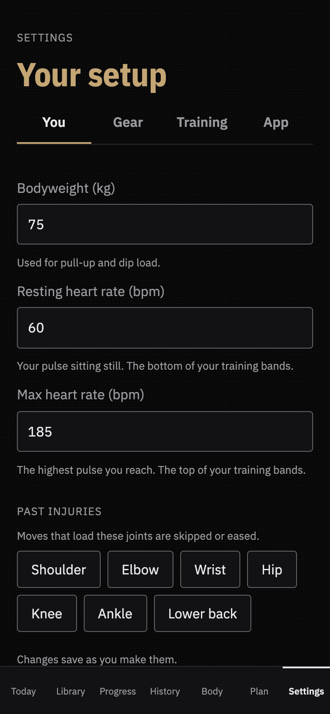
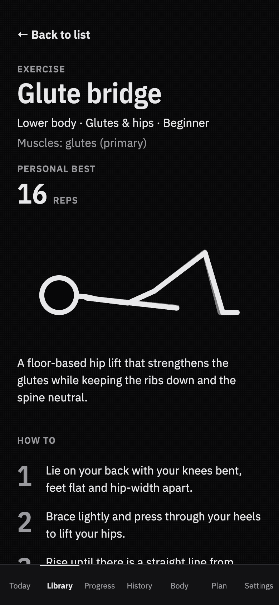
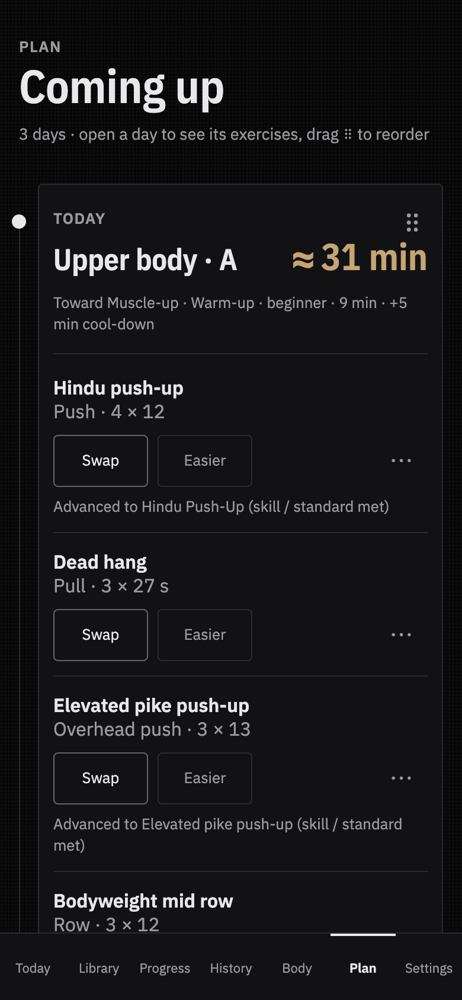
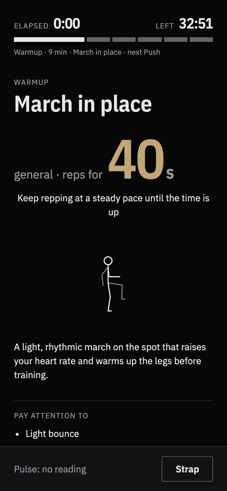
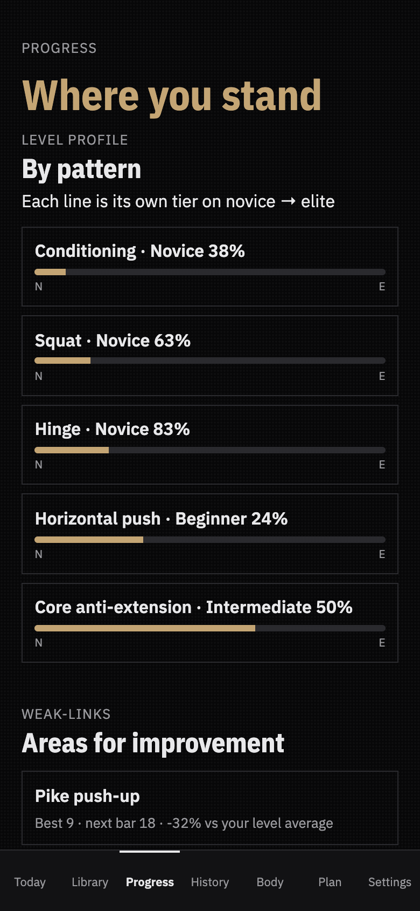
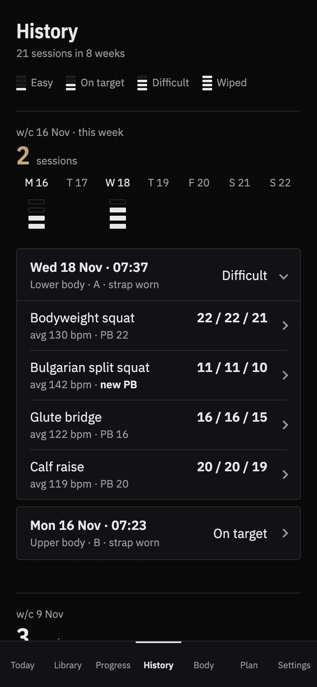
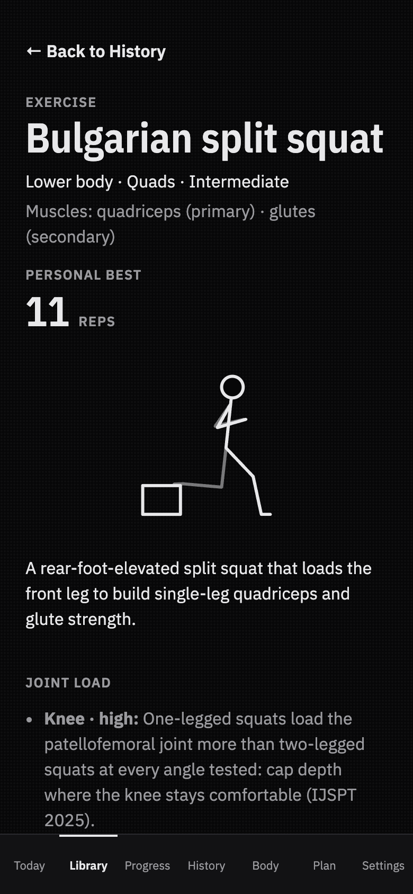
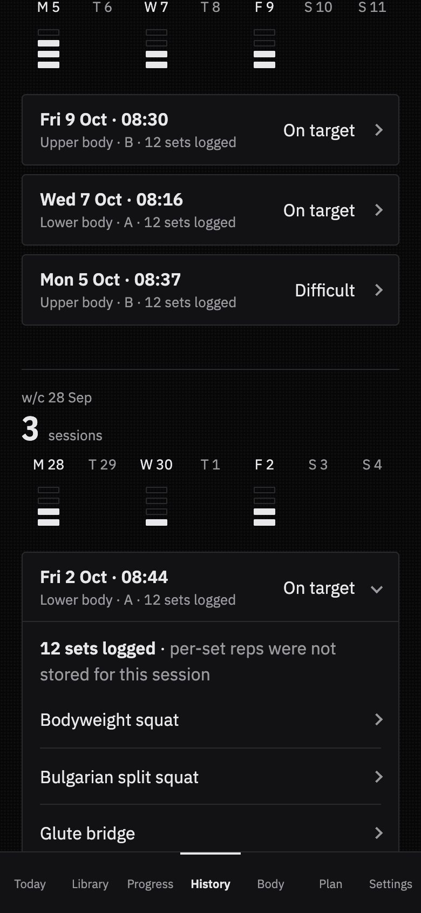
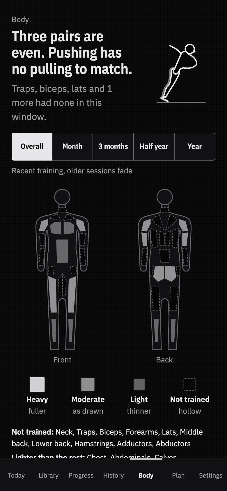
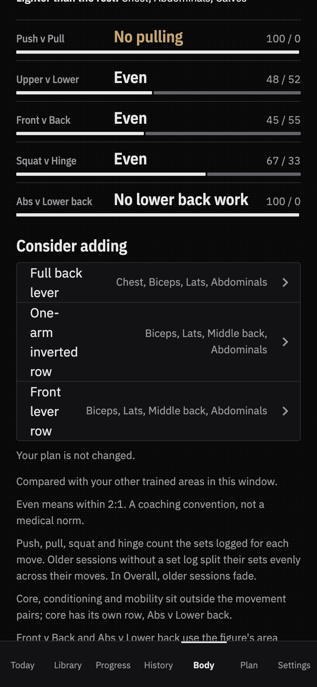

# Take your first morning with Aurora

## Overview

The first open needs a fixed path. Aurora · Rassvet is private calisthenics training on Android: British English UI and voice (`en-GB`). This tutorial walks the product once, in one order, with every choice already made for you.

The path is Settings, Library, Plan, Today, Session, Progress, History, Body. By the end you will have filled who you are and what gear you own, read the plan queue without editing it, finished one logged session, and opened the three feedback surfaces.

The tutorial assumes you can sideload an Android APK, train bodyweight or bar work at a beginner or intermediate level, and read short British English on a phone.

Screenshots use the Rassvet palette (brass on near-black) and the browser preview. History, Body, and Progress show eight weeks of invented sample training (Upper body · B and Lower body · A, with no pulling), so those screens are not empty. Your own screens will differ. The screenshots describe the current `dev` build; History weeks and the balance-first Body tab arrive in the next release after v0.1.2.

## Background

Most training apps use a weekday calendar. Aurora does not. It keeps a **plan queue**, an ordered list of upcoming training days. **Today** always runs the first item. Completing a session advances the queue.

The **dose** is the prescribed sets and reps or hold for each station. Sleep quality, optional pain, recent load, and pulse on the Android app can lighten that dose when you start.

Training history, readiness, sleep, pulse, and related health signals stay on the device in version 0.1. On Android they sit in **AuroraSecure**, Keystore-backed storage rather than plaintext. Privacy: [../PRIVACY.md](../PRIVACY.md). Tab names and fields: [../reference/aurora-shell-tabs.md](../reference/aurora-shell-tabs.md).

The tutorial consists of eight parts: setup, Library, Plan, Today, Session, Progress, History, and Body.

## Before you start

1. Install the Aurora APK from the [latest GitHub Release](https://github.com/avnovikov/aurora/releases/latest). Confirm the signing certificate SHA-256 against the root README if you want to verify the file.
2. Keep about 35–45 minutes free for a full first session. A browser preview (`npm run dev -- --host`) is enough for setup and browsing only; a pulse strap needs the Android app.
3. Keep phone sound on. Starting a session turns on the coach voice.
4. Clear floor space and have any gear you own nearby. You will mark gear in Settings; the planner respects what you own.

## Set who you are

On first launch the app opens **Your setup** before the main tab bar. If setup is already done, open **Settings** and use the **You** tab. The fields are the same.

1. Enter bodyweight in kilograms. The value feeds pull-up and dip load estimates.
2. Enter resting heart rate in bpm (pulse sitting still; the bottom of your training bands) and max heart rate in bpm (the top of those bands).

    

3. Under Past injuries, tap every joint that still limits you. Moves that load those joints are skipped or eased. Leave chips off if none apply. Changes save as you make them.
4. Open the Gear tab. Turn on every piece of equipment you have (body, bar, parallettes, and so on). The planner will not prescribe moves that need gear you left off.
5. Open Training and leave the defaults. Leave App on the Rassvet palette with voice unmuted.
6. Tap Continue if you are still in first-run setup.
7. On What to train first, tap Upper body, then tap Start with this.

    That choice seeds the plan queue with upper-body days. This tutorial stays on that path.

    

You should now see the main tab bar: Today, Library, Progress, History, Body, Plan, Settings.

## Look around the Library

1. Tap Library.

    The list is the exercise catalogue. Each row shows name, area · muscle · level, and a short description. Filters sit under the list: Show, Area & muscle, Level. Stretches stay hidden until Show asks for them.

    

2. Tap a Beginner row (for example Glute bridge) to open detail. Watch the doodle, a looping line drawing of the movement; nearly every Library move has one. Read your personal best if you have logged the move, then the description, cues and standards strip if present.

    

3. Return to the list with Back to list, a swipe to the right, or the phone’s Back.
4. Do not tap Generate plan or Add to day. Those come after you know how Today works.

Three rules follow. Moves are labelled by area and level. Detail holds the doodle, cues and standards. You do not edit the plan from Library on this pass.

## Read the Plan queue

1. Tap Plan.

    Coming up lists the queue. The first card is Today. Each card shows the day name (for example Upper body · A), an ≈ minute estimate, warmup and cool-down notes, and the working exercises with Swap, Easier, and more options. Some later cards may be skill paths with a **Target** (for example handstand or muscle-up) — that Target is the end skill; the day still trains the step you can do now.

    

2. Confirm the first card is labelled Today and that its area is Upper body.
3. Scroll far enough to see Then 2 or Then 3 if present. Leave Swap, Easier, remake, and reorder alone. If a skill Target appears on a later card, note the name; you will see distance toward Targets on Progress after you log.
4. Note the level controls lower on the page (From my results / named levels). Leave From my results selected.

The queue is what Today will run. You do not need to edit it to train.

## Check in on Today

1. Tap Today.

    You see the next queue day, ≈ minutes, pulse status, sleep chips, optional pain chips, and Start.

    

2. If you use a BLE heart-rate strap on the Aurora Android app, tap Connect and wait until the status shows a reading. If you have no strap, leave pulse as “no reading” and continue.
3. Under How did you sleep?, tap Good. Start stays disabled until a sleep choice is made. This tutorial uses Good so you see the normal morning dose; Fair or Poor would lighten it.
4. Leave pain chips off unless something hurts today. Marked pain eases or skips moves that load that joint.
5. Tap Start for the named day (for example Start Upper body · A). The coach voice starts. Keep the volume up.

## Run a Session

The Session replaces the tab bar until you finish. It runs warmup, then work patterns, then cool-down, then a short rating.

1. On the first warmup station, find Elapsed and Left, the stage strip, the station name, the dose (reps for a time, or a hold), the cues, and the doodle.

    

2. Work the station as written. When the prompt says to finish, or when the station clock ends, swipe left (right edge toward left) to commit. Rest and get-ready screens use the same forward swipe. A swipe the other way snaps back.
3. On rest screens, wait for the countdown, or swipe left to skip ahead when the UI allows. If pulse is connected and still high, rest may hold; follow the on-screen prompt.
4. Continue through each work station. Log the reps or hold you actually did when the UI asks. That memory drives Progress and the next Plan.
5. Use Not for me only if a move is unsafe for you today. The session replaces it and continues. Do not use it for ordinary difficulty on this pass.
6. Finish cool-down, then complete the short session rating. The app returns you to the shell and advances the plan queue.

You have now completed one logged morning.

## Open Progress

1. Tap Progress.

    Where you stand has three boards. The **level profile** is pattern-by-pattern standing on novice → elite, with a within-tier percentage. **Weak-links** are moves that sit below your average. **Current readiness** is distance toward a **Target** — a skill goal on Plan such as freestanding handstand or muscle-up — and what to clear next on that path. You train today’s step; Progress shows how close the Target still is.

    

2. Scroll through all three boards once. After a logged session the profile should show at least some pattern lines. Empty boards mean not enough sets yet. If a readiness row names a Target, read it as “how close am I?” — not as a second plan editor.
3. If a readiness row is present, tap it. History opens filtered for that thread. Press Back (or the phone’s Back) to return to Progress, then continue.

Do not change Plan Targets from Progress on this pass. Setting or remaking a skill Target happens on Plan after you know the loop.

## Open History

1. Tap History.

    The lede counts your sessions and weeks. Under it, the effort key shows the four ratings you choose at the end of a session as one to four filled steps: Easy, On target, Difficult, Wiped.

    Sessions are grouped by week, Monday to Sunday, newest first. Each week starts with its label (w/c 16 Nov · this week), the number of sessions, and a Mon–Sun strip. A training day shows a bar filled to that session’s effort; a rest day is blank. Tap a bar to open that day’s session.

    

2. Read the open card. The newest session opens by itself. Its title is the day and time, the line under it names the plan day (for example Lower body · A, plus “strap worn” when a heart-rate strap was connected), and the rating sits on the right.

    Each exercise row shows the reps of every set (22 / 22 / 21), then the average heart rate for that move when a strap was worn, then your personal best (PB 22). A row reads **new PB** when that session’s best set beat every set logged for the move before. Older cards stay closed; tap one to open it.

3. Tap one exercise row. Its Library page opens with Back to History at the top.

    

4. Press Back to History (or the phone’s Back). You land on History where you left it.
5. Scroll down to the oldest weeks. Sessions logged before Aurora stored each set show “12 sets logged” and their exercise names, with no reps and no PB marks. That limit is real for older logs; new sessions keep set-level detail.

    

## Open Body

Body answers one question: is your training balanced?

1. Tap Body.

    The headline names balance in pairs, never single body areas: in the sample, “Three pairs are even. Pushing has no pulling to match.” The line under it names areas that had no work. Beside the headline, a small animated caricature exaggerates the most uneven pair, or the two most uneven pairs together; when every pair is even, it shows an even figure.

    

2. Leave the window on Overall. Overall counts recent training in full and lets older sessions fade. Month, 3 months, Half year and Year count every session in that window the same.
3. Read the figure, front and back. Each area is drawn at one of four levels, compared with your other trained areas in the window: Heavy (fuller), Moderate (as drawn), Light (thinner), and Not trained (a dashed, see-through outline). The two lines under the key list the Not trained areas and those lighter than the rest.
4. Scroll to the balance rows.

    

    Five rows compare Push v Pull, Upper v Lower, Front v Back, Squat v Hinge, and Abs v Lower back. Each row has a word, the two shares, and a split bar. **Even** means the smaller side has at least a third of the work (within 2:1, a coaching convention, not a medical norm). **Mostly push** means the smaller side has some work but less than a third. **No pulling** means the smaller side has none. The most uneven pair’s word is the only one in the accent colour.
5. Read Consider adding. It lists up to three Library moves for the light side, chosen from gear you own, with the areas each one trains. Moves are ranked by how many light areas they cover, not by difficulty, so the list can name advanced moves; check the level before you add one. Tap a move to open its page, then press Back to return to Body with the same window. Your plan is not changed.
6. Tap Month once to see the balance for the last 30 days, then return to Overall.

You have now seen setup, the queue, a full session, and the three feedback surfaces.

## Summary

In this tutorial you filled You and Gear, seeded Upper body, browsed Library and its doodles, read Plan without editing, checked in on Today, finished a Session with swipe-to-commit, read Progress, read your weeks and personal bests on History, read the balance on Body, and used Back to return from an exercise page.

## Next steps

| Doc | What it holds |
|-----|----------------|
| [Shell tabs reference](../reference/aurora-shell-tabs.md) | Tab, session, and storage lookup |
| [Privacy](../PRIVACY.md) | Local-only data; GDPR and CCPA/CPRA |
| [Terms](../TERMS.md) | Use conditions and disclaimer |
| [Root README](../../README.md) | Install, signing fingerprint, develop commands |
