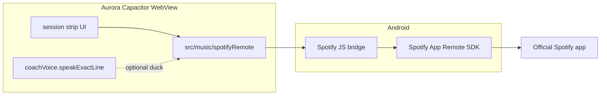

# Research: Spotify session remote

> Feature: 2026-11-17-spotify-integration | Context: README.md | Date: 2026-11-17

## Overview

Add a Waze-style **player strip** during Aurora sessions that **remotes the official Spotify app** — now-playing, play / pause / skip — so music stays available without leaving the workout. Clarified product intent: **player and control only**, not in-app streaming, playlist browsing, or recommendations.

Canonical implementation surface for this research is the Capacitor Android app in `.claude/worktrees/agent-a9bea994d569da82b` (full `src/`, `android/`, voice, Pulse). The main checkout `src/` is a thin shell and is not a viable mount point. `.worktrees/desk-design` shares the same session/voice patterns but lacks the `AuroraSecure` bridge.

## Key Takeaways

1. **Difficulty: Medium (~2–5 focused days for a solid MVP on Capacitor Android; ~1 day for a UI stub + fake remote).** The hard work is a native App Remote bridge and auth, not TS session UI — the session bar and Pulse adapter already show where controls and platform gating go (`.claude/worktrees/agent-a9bea994d569da82b/src/ui/sessionChalk.ts:96-108`, `…/src/pulse/hrMonitor.ts:57-65,117-125`).
2. **Web Playback / in-app streaming is out.** Spotify audio must keep playing in Spotify; Aurora only sends commands and reads metadata. That matches the clarified scope and avoids DRM/WebView streaming fragility.
3. **JS alone cannot remote Spotify.** Capacitor WebView UI needs a native bridge (App Remote SDK or equivalent), same class of seam as `AuroraSecure` on `MainActivity` (`.claude/worktrees/agent-a9bea994d569da82b/android/app/src/main/java/com/aurora/rassvet/MainActivity.java:13-19`).
4. **Coach voice does not duck music today.** `speakExactLine` only stops Aurora’s own WAV/TTS (`.claude/worktrees/agent-a9bea994d569da82b/src/voice/coachVoice.ts:76-90,98-99`). Without a remote pause/duck at that choke point, coach and Spotify fight at the OS mixer.
5. **Do not touch `rules/` or `domain/` planning.** Music is I/O; keep it in new `src/music/` + session UI, mirroring Pulse — pure rest/hold cue schedules stay Spotify-free (`.claude/worktrees/agent-a9bea994d569da82b/src/voice/restCue.ts`, `holdCue.ts`).
6. **Shipping constraints must be UX copy, not silent failure:** Spotify app installed; Premium often required to start a track/playlist URI; web/dev builds get an explicit “needs Android + Spotify” message like Pulse (`…/src/pulse/hrMonitor.ts:38-40`).

## Target State

```text
.claude/worktrees/agent-a9bea994d569da82b/   (or successor merge branch)
├── src/
│   ├── music/
│   │   ├── spotifyRemote.ts     NEW — connect, play/pause/skip, now-playing, test inject
│   │   └── duckWithCoach.ts     NEW — optional pause around speakExactLine
│   ├── voice/
│   │   └── coachVoice.ts        MODIFIED — call duck hooks at speakExactLine (optional phase)
│   ├── ui/
│   │   ├── sessionChalk.ts      MODIFIED — player strip in session-bar
│   │   ├── sessionSpotify.ts    NEW — in-place paint like sessionPulse
│   │   ├── sessionControls.ts   MODIFIED — wire data-spotify-* controls
│   │   └── sessionView.ts       MODIFIED — lifecycle + handlers
│   └── pulse/hrMonitor.ts       unchanged — pattern reference only
├── android/
│   └── app/src/main/java/com/aurora/rassvet/
│       ├── MainActivity.java    MODIFIED — register Spotify remote bridge
│       └── spotify/             NEW — App Remote wrapper + JS interface
└── tests/
    ├── music/                   NEW — adapter + duck unit tests
    └── ui/                      MODIFIED — strip markup + control wiring
```

## What Will Be Done

- Session footer shows a compact Spotify strip: title/artist (or status), play/pause, skip.
- On Capacitor Android with Spotify installed, Aurora connects via App Remote and controls playback.
- Web / missing Spotify / disconnect paths show explicit status strings (Pulse-style).
- Optional phase: pause Spotify when coach speaks, resume after the line.
- Unit tests cover the adapter with an injected fake client; UI tests assert strip markup.

## What Will Not Be Done

- Web Playback SDK streaming inside Aurora — out of clarified scope; DRM/WebView risk.
- Playlist browser, search, recommendations, or “workout playlist product” — deferred; user picks music in Spotify (or a later prefs URI).
- Coupling dose/rules to BPM of tracks or music mood — out of scope.
- Apple Music / YouTube Music parity — out of this feature.
- Token-swap Lightsail service unless App Remote auth forces it — prefer built-in App Remote auth first.

## Recommended Implementation Plan

Phased so a usable remote lands before coach ducking polish.

### Phase 1: Fake remote + session strip — Preliminary Spec

```text
Phase: Session strip with injectable remote
Change-Name: spotify-strip-stub
Context: Session bar and Pulse in-place paint exist; no music module
Objective: Ship UI + TS contract without native Spotify yet

Scope:
- src/music/spotifyRemote.ts — CREATE — client interface, no-op/web messages, setSpotifyClientForTests
- src/ui/sessionSpotify.ts — CREATE — paintNowPlaying in-place
- src/ui/sessionChalk.ts — MODIFY — strip slot in pulseBarHtml
- src/ui/sessionControls.ts / sessionView.ts — MODIFY — wire controls
- tests/ui/* — MODIFY — assert strip + clicks against fake client

Tasks:
1. Define SpotifyRemoteClient: connect, disconnect, play, pause, skipNext, getPlayerState, subscribe
2. Web path returns ok:false with “Spotify remote needs the Aurora Android app”
3. Add strip markup next to pulse chip; avoid full shell repaint for metadata (copy paintPulseReading)
4. Wire data-spotify-play|pause|skip handlers

Acceptance Criteria:
- [ ] npm test covers fake connect + button handlers
- [ ] shellHtml includes strip selectors on a work-phase ViewState
- [ ] rules/ and domain/ unchanged

Given a session in work phase with a fake remote reporting “Song A” paused
When the user taps play on the strip
Then the fake remote play() is called once and the strip shows playing
```

### Phase 2: Android App Remote bridge — Preliminary Spec

```text
Phase: Native App Remote
Change-Name: spotify-app-remote-android
Context: Phase 1 strip + TS adapter; MainActivity already hosts AuroraSecure
Objective: Real control of the installed Spotify app from Capacitor

Scope:
- android/.../spotify/* — CREATE — App Remote connect + PlayerApi
- MainActivity.java — MODIFY — attach JS bridge
- src/music/spotifyRemote.ts — MODIFY — resolve native client when isNativePlatform
- AndroidManifest / gradle — MODIFY — Spotify SDK + redirect if required

Tasks:
1. Add Spotify App Remote dependency; register developer Client ID
2. Bridge: connect, pause, resume, skip, player-state callbacks → JS
3. Explicit errors: Spotify not installed, auth denied, Premium required for URI play
4. Manual verify on device with Spotify Premium

Acceptance Criteria:
- [ ] From a live session, pause/skip changes Spotify playback
- [ ] Now-playing title updates without resetting the session shell
- [ ] Missing Spotify shows a clear status string in the bar
```

### Phase 3: Coach ducking (optional) — Preliminary Spec

```text
Phase: Pause Spotify around coach lines
Change-Name: spotify-duck-coach
Context: Phases 1–2 working; speakExactLine is the single coach choke point
Objective: Coach lines win the ear briefly, then music resumes

Scope:
- src/music/duckWithCoach.ts — CREATE
- src/voice/coachVoice.ts — MODIFY — await duck before play; restore after ended/error
- tests/music + mocked sessionRestPulse — MODIFY

Tasks:
1. On speakExactLine: remote pause (or volume duck if API allows)
2. On HTMLAudioElement ended / TTS end / mute: resume if we paused
3. Skip duck when coach muted or remote disconnected

Acceptance Criteria:
- [ ] Unit test: speakExactLine with fake remote calls pause then resume
- [ ] Dense rest countdown still audible over music on device
```

## Architecture



| Layer | Role |
|-------|------|
| `ui/sessionChalk` + `sessionSpotify` | Markup + in-place now-playing paint |
| `music/spotifyRemote` | Platform adapter (native / web / test) |
| `android/.../spotify` | App Remote SDK ownership |
| `voice/coachVoice` | Optional duck caller only |
| `rules/*` / `domain/*` | Untouched |

## Detailed Findings

### Existing audio (coach only)

- Mute + stop own WAV/TTS: `.claude/worktrees/agent-a9bea994d569da82b/src/voice/coachVoice.ts:8-30`
- Unlock on Start tap: `…/src/ui/app.ts:131-132`, `…/coachVoice.ts:36-59`
- All coach speech funnels through `speakExactLine`: `…/coachVoice.ts:65-90`
- Rest cue density (banter, get ready, countdown, go): `…/src/voice/restCue.ts:55-78` wired from `…/src/ui/sessionRest.ts`

### Session chrome (strip mount)

- Sticky footer: actions → pulse status → pulse chip → Strap details: `…/src/ui/sessionChalk.ts:96-108`
- Full `paint()` rewrites shell HTML: `…/src/ui/sessionView.ts` (repaint path); Pulse avoids that for BPM via `paintPulseReading`: `…/src/ui/sessionPulse.ts:104-121` — **now-playing must follow the same in-place rule** or swipes break.

### Native / Capacitor precedents

- App id `com.aurora.rassvet`, `webDir` `dist`, HTTPS scheme: `…/capacitor.config.ts:3-9`
- Custom bridge pattern: `…/MainActivity.java:13-19`, `…/src/storage/auroraSecure.ts:4-42`
- Dynamic native plugin + test inject: `…/src/pulse/hrMonitor.ts:51-65,117-125`
- Dependencies today: Capacitor 8 + BLE only — `…/package.json:43-48` (no Spotify)

### Storage

- Versioned KV keys in `STORAGE_KEYS`: `…/src/storage/storageKeys.ts:5-29`
- Secure store on native via AuroraSecure — suitable later for OAuth tokens if needed; **MVP App Remote may not need persisted tokens** if using built-in remote auth.

### Repo layout caveat

- Main `/Users/alexei/Documents/calistenics/src/main.ts` is not the session app; implement on the Capacitor worktree / branch that carries `src/session`, `src/voice`, `android/`.

## Patterns and Conventions

- Platform gating with explicit user-facing messages (`PULSE_STRAP_NEEDS_ANDROID_APP` pattern).
- `setXClientForTests` injection for Vitest without real native SDKs.
- Keep pure schedules (`restCue`, `holdCue`) free of I/O imports.
- British English UI copy; fail closed with clear status, not silent no-ops.

## Testing Landscape

| Area | Strength | Evidence |
|------|----------|----------|
| Session bar HTML via `shellHtml` | Strong | `tests/ui/sessionScreen.test.ts` |
| Coach mocks + fake timers | Strong | `tests/ui/sessionRestPulse.test.ts`, `tests/voice/restCue.test.ts` |
| Capacitor / bridge mocks | Strong | `tests/storage/migrateSecureStorage.test.ts` |
| Spotify-specific | Thin | None |

## Behavioral Scenarios

Given a Capacitor session with Spotify installed and App Remote connected, track “Iron Lung” playing  
When the user taps pause on the Aurora strip  
Then Spotify pauses and the strip shows paused with the same title  

Given Spotify is not installed on the device  
When the user opens a session and the strip tries to connect  
Then the bar shows a clear “Install Spotify” (or equivalent) status and no crash  

Given coach voice unmuted and Spotify playing  
When a rest “go” cue fires  
Then (with Phase 3) Spotify is paused for the cue and resumes afterward; (without Phase 3) both may play and the user relies on OS mix  

Given web `npm run dev` without native bridge  
When the user taps a Spotify control  
Then the strip shows that remote needs the Android app (same discipline as Pulse)

### Scenario Notes

- “Start this playlist URI” can wait; MVP is control of whatever Spotify is already playing.
- Premium gating applies when/if “play URI” is added later.

## Issues and Risks

- **Spotify app dependency** — App Remote requires the official app; must match Pulse’s explicit degraded UX.
- **Premium for play-by-URI** — pause/skip of current context often works more broadly; starting a URI often needs Premium (external Spotify policy).
- **Auth / Client ID** — Developer Dashboard app + redirect / App Remote auth; possible token-swap server if scopes expand — not in Lightsail static hosting today.
- **Wake lock on app switch** — `wakeLock` releases when document hidden (`.claude/worktrees/agent-a9bea994d569da82b/src/session/wakeLock.ts:94-98`); jumping into Spotify briefly can drop keep-awake until return.
- **Bar crowding** — Work phase already pins Log set / fail / skip in the footer (`sessionChalk.ts:67-73`); strip must stay chip-sized or collapsible.
- **Main vs worktree drift** — desk-design lacks AuroraSecure; merge target must be the secure Capacitor tree.

## Coverage Assessment

| Category | Status | Notes |
|----------|--------|-------|
| Existing Implementation | Partial | Coach/session Strong; Spotify Thin (absent) |
| Architecture Impact | Strong | Clear seams: music adapter + session bar + MainActivity |
| Dependencies | Partial | Capacitor/BLE present; Spotify SDK absent |
| Data Model | Partial | KV/profile Strong; no music state yet (MVP mostly ephemeral) |
| Integration Points | Strong | pulseBarHtml, speakExactLine, hrMonitor pattern |
| Testing Landscape | Strong | Patterns exist; Spotify tests Thin |
| Edge Cases & Risks | Strong | Install/Premium/ducking/wake-lock identified |
| Prior Art | Strong | hrMonitor + AuroraSecure + sessionPulse |
| Behavioral Specification | Strong | Remote-control scenarios above |

## Gaps & Caveats

- Exact Spotify Android SDK version and auth flow (built-in App Remote vs Auth Library + token swap) not proven on-device in this repo — validate in Phase 2 spike.
- Whether Free accounts can pause/skip current playback without URI play is a device check, not a codebase fact.
- iOS out of product scope today (Android Capacitor); App Remote would need a separate iOS pass later.
- Spec framework: none detected (`openspec/`, `.specify/`, `.kiro/specs/` absent); paste-ready phase blocks above are research-level only.

## Human-in-the-Loop (HITL) Review

Every item has a *(recommended)* default. To accept all defaults, proceed without a response. To override, list only the items you want changed (e.g., `S1.B, Q3.C`).

### Steering Opportunities

> **S** = Steering — approve, veto, or redirect a direction this research committed to.

S1. **Transport** Clarified “player + control” points at remoting the official Spotify app, not streaming inside Aurora.  
    A) App Remote on Capacitor Android only *(recommended)* B) Web Playback in WebView C) Both with feature flag

S2. **Coach vs music** Whether MVP must auto-pause Spotify for coach lines.  
    A) Strip only in MVP; ducking later *(recommended)* B) Ducking required for MVP C) Never auto-duck — user handles volume

### Outstanding Questions

> **Q** = Question — resolve an open ambiguity so planning can proceed.

Q1. **Default music** On connect, only control whatever is already playing, or also offer “play this playlist URI”?  
    A) Control current context only in MVP *(recommended)* B) Also play a saved playlist URI C) Deep-link out to Spotify to pick, then return

Q2. **Merge base** Implement on which tree?  
    A) Capacitor worktree / branch that has AuroraSecure + full session (`agent-a9bea994d569da82b` lineage) *(recommended)* B) desk-design first C) Wait until main catches up

### KISS/YAGNI Check

> **K** = KISS/YAGNI — keep it simple; you aren't gonna need it. Agree to narrow scope or confirm the current approach.

K1. **Playlist product** Working notes once mentioned playlist selection; clarified scope drops it.  
    A) Keep playlist URI prefs out of MVP *(recommended)* B) Add one hard-coded playlist URI C) Build a picker UI now

K2. **Persisted link state**  
    A) Ephemeral connect each session *(recommended)* B) Persist “linked” + tokens in secure store from day one

---
*No response = all *(recommended)* defaults applied. Override format: `S1.B, Q3.C` (only the items you want to change). Free-form feedback also accepted. Resolve before planning.*
